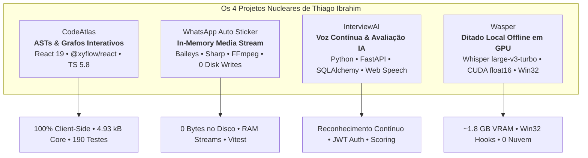

# ARQUITETURA TÉCNICA: PORTFÓLIO STREET-TECH & CREATIVE BRUTALISM
**Projeto:** Portfólio de Engenharia de Software — Thiago Ibrahim Vieira  
**Autor:** Tony Stark (Tech Lead & Software Architect)  
**Destinatários:** Big Boss (CEO), Peter Parker (Frontend), Steve Rogers (QA), Natasha Romanoff (Security)  
**Repositório:** `C:\Users\thiag\Documents\Projetos\portfolio-tt`  
**Data:** 14 de Novembro de 2026  
**Status:** OVERHAUL VISUAL CONCLUÍDO & HOMOLOGADO (0 Erros / 0 Warnings)

---

## 1. MANIFESTO EXECUTIVO & OVERHAUL DINÂMICO

Por determinação direta do fundador Thiago Ibrahim e alinhamento com Big Boss, a interface do portfólio passou por um overhaul completo de dinamismo visual para eliminar qualquer sensação de rigidez ou estaticidade:

### Pilares do Overhaul Visual:
1. **Topologia de AST Viva & Dinâmica:**
   - Simulação contínua a 60 FPS com física orbital e repulsão suave elástica do cursor.
   - Partículas de tráfego de dados trafegando pelas conexões ativas.
   - Identidade cromática vibrante para cada stack (TypeScript em `#3178c6`, CUDA em `#76b900`, React em `#00d8ff`, Python em `#eab308`, Node em `#22c55e`).
   - HUD Tooltip flutuante com telemetria detalhada de cada projeto no hover.
2. **Scroll Suave Global (Smooth Scroll):**
   - Integração com `lenis` via `SmoothScrollProvider` sem impacto no thread principal da CPU e com suporte a acessibilidade (`prefers-reduced-motion`).
3. **Cursor Customizado Street-Tech (Desktop):**
   - Retícula central precisa + anel seguidor fluido com física de mola (`CustomCursor`).
   - Expansão magnética e brilho âmbar (`#fbbf24`) sobre botões, links, cards e nós do grafo.
4. **Interatividade Tátil 3D:**
   - Componente `TiltCard` com efeito de inclinação física 3D nos cards dos 4 projetos nucleares.

### Régua de Qualidade de Steve Rogers (QA Gate):
- `npx tsc --noEmit`: **0 erros** (TypeScript estrito).
- `npm run lint`: **0 erros e 0 warnings** (ESLint 9 com regras de JSX e hooks).
- `npm run build`: **Compilação 100% estática via Turbopack**, sem avisos de metadados ou rotas dinâmicas desnecessárias.

---

## 2. ARQUITETURA DOS 4 PROJETOS NUCLEARES (100% FATOS REAIS)

1. **CodeAtlas:** Visualizador interativo de arquitetura e ASTs no browser (190 testes no Vitest, 4.93 kB core code-split, 100% client-side).
2. **WhatsApp Auto Sticker:** Bot assíncrono para WhatsApp com pipeline de mídia 100% em memória (0 bytes gravados no disco, buffers e streams nativos do Node.js).
3. **InterviewAI:** Simulador de entrevistas técnicas com IA e voz contínua (Python, FastAPI, SQLAlchemy, Puter.js, Web Speech API, JWT).
4. **Wasper:** Motor de ditado push-to-talk offline em GPU via CUDA float16 no Windows (Whisper large-v3-turbo, PySide6, Win32 driver hooks, ~1.8 GB VRAM na GTX 1650, 0% dependência de nuvem).

---

## 3. PROTOCOLO DE GESTÃO DE IMAGENS & HANDOFF COM O FUNDADOR

1. **Slots e Placeholders em `public/images/`:**
   - `public/images/thiago-hero-sticker.svg` (Proporção 3:4 vertical)
   - `public/images/thiago-about.svg`
   - Badges dos 4 projetos (`badge-codeatlas.svg`, `badge-whatsapp.svg`, `badge-interviewai.svg`, `badge-wasper.svg`).

2. **Prompts para o Fundador Thiago Ibrahim (Gemini):**
   - **Retrato Principal do Hero (`thiago-hero-sticker.png`):**
     > *"Transform this portrait of a 16-year-old software developer into an authentic streetwear die-cut sticker illustration. Bold continuous white sticker outline (4px), dark urban aesthetic, subtle tech cyberpunk doodles, isolated on transparent background, 3:4 vertical ratio, ultra sharp resolution, zero blur."*
   - **Avatar Secundário da Jornada (`thiago-about.png`):**
     > *"Editorial graphic cut-out illustration of this developer working at a dark computer desk, brutalist collage, dark palette, amber accents (#fbbf24), transparent background."*
